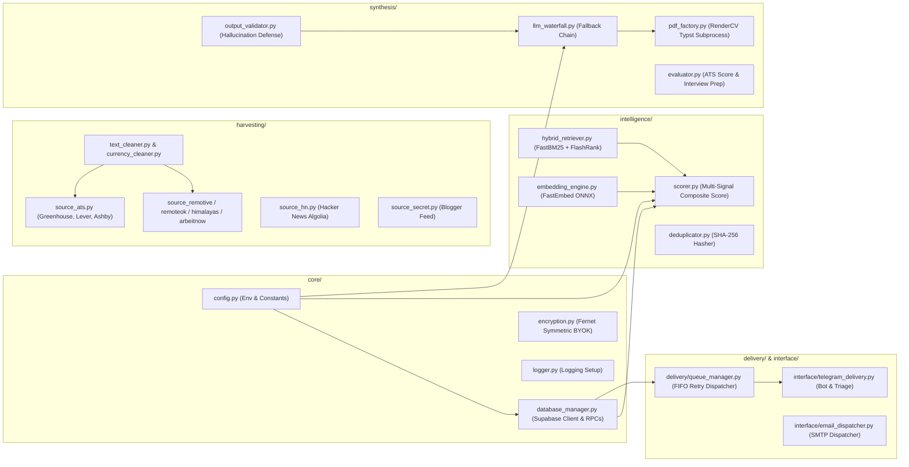
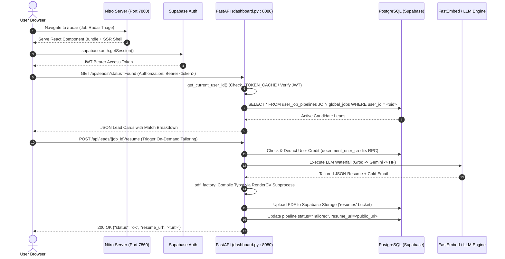
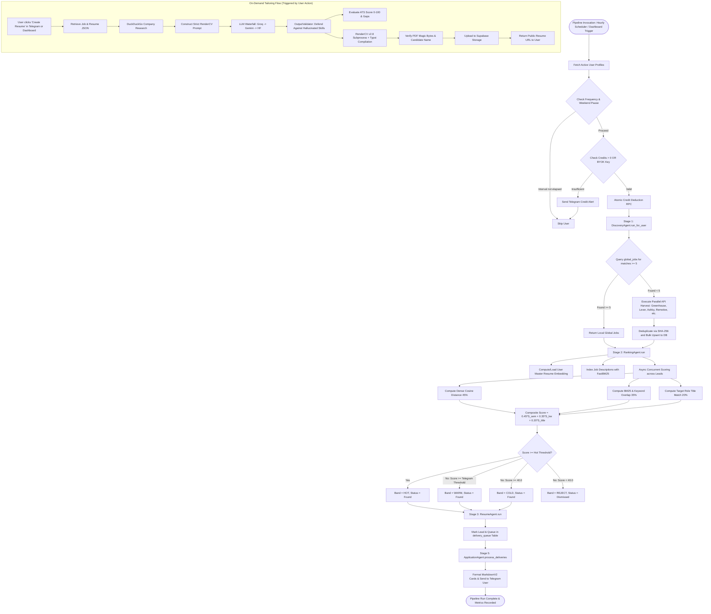
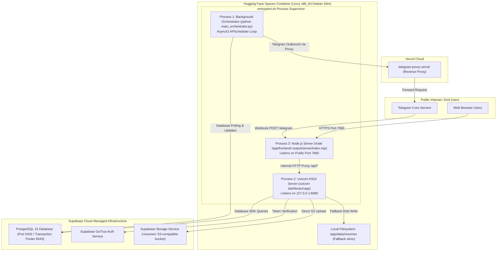

# PhantmOS System Architecture & Design Specification (v3.0.0)

**Audit Date:** October 18, 2026  
**Auditor:** Senior Software Architect  
**Scope:** Structural blueprints, process lifecycles, data models, and deployment topologies reconstructed from source code.

---

## 1. High-Level System Architecture

PhantmOS is an autonomous, multi-agent AI job discovery and resume synthesis platform. It operates as a dual-runtime container combining a Python 3.12 backend (FastAPI API server and autonomous APScheduler background daemons) with a Node.js v20 frontend (TanStack Start / Nitro server-side and client-side rendering).

```mermaid
graph TD
    subgraph ClientLayer["Client & Delivery Tier"]
        Browser["Modern Web Browser (TanStack Start React 19)"]
        TG["Telegram Client (Interactive Triage Mini App)"]
    end

    subgraph IngressLayer["Ingress & Routing (Hugging Face Spaces Port 7860)"]
        Nitro["Node.js Nitro Server (Port 7860)"]
        VercelProxy["Vercel Telegram Proxy (Reverse Proxy)"]
    end

    subgraph BackendLayer["Backend Application Tier (Internal Port 8080)"]
        FastAPI["FastAPI Dashboard Application (dashboard.py)"]
        Orchestrator["Autonomous Scheduler Daemon (main_orchestrator.py)"]
        HarvesterDaemon["Global Background Harvester (global_harvester.py)"]
    end

    subgraph AgentLayer["Discrete Stateless Multi-Agent Tier (agents/)"]
        DiscoveryAgent["DiscoveryAgent (Stage 1)"]
        RankingAgent["RankingAgent (Stage 2)"]
        ResumeAgent["ResumeAgent (Stage 3)"]
        AppAgent["ApplicationAgent (Stage 5)"]
        AnalyticsAgent["AnalyticsAgent (Digest/Metrics)"]
    end

    subgraph IntelligenceLayer["Local Embedding & Algorithmic Core"]
        FastEmbed["FastEmbed ONNX (bge-small-en-v1.5)"]
        FastBM25["FastBM25 Okapi Engine (Lexical)"]
        FlashRank["FlashRank Cross-Encoder (TinyBERT)"]
        RRF["Reciprocal Rank Fusion (RRF)"]
    end

    subgraph SynthesisLayer["LLM Waterfall & Document Synthesis"]
        Waterfall["LLM Waterfall (Groq -> Gemini -> HF)"]
        Validator["Output & Hallucination Validator"]
        RenderCV["RenderCV v2.8 Engine + Typst Compiler"]
    end

    subgraph PersistenceLayer["Cloud Persistence Tier (Supabase)"]
        Postgres[("PostgreSQL 15 Database (RLS Enforced)")]
        Storage[("Supabase Object Storage ('resumes' bucket)")]
        Auth["Supabase Auth (JWT Bearer Verification)"]
    end

    Browser -->|HTTP / SPA Navigation| Nitro
    Nitro -->|Proxy API Requests| FastAPI
    TG -->|Webhook / Callbacks| FastAPI
    TG -->|Outbound API via Proxy| VercelProxy
    FastAPI -->|JWT Authentication| Auth
    FastAPI -->|PostgreSQL Queries & RPCs| Postgres
    FastAPI -->|On-Demand PDF Generation| RenderCV
    RenderCV -->|Upload Generated PDF| Storage

    Orchestrator -->|Cron / Hourly Triggers| DiscoveryAgent
    Orchestrator -->|Evaluate Scored Leads| RankingAgent
    Orchestrator -->|Queue On-Demand Tailoring| ResumeAgent
    Orchestrator -->|Dispatch Telegram Queue| AppAgent

    DiscoveryAgent -->|Local-First & API Ingestion| HarvesterDaemon
    RankingAgent -->|Dense Embeddings| FastEmbed
    RankingAgent -->|Lexical Scoring| FastBM25
    RankingAgent -->|Precision Rerank| FlashRank
    RankingAgent -->|Fuse Rankings| RRF

    ResumeAgent -->|Prompt Generation| Waterfall
    Waterfall -->|Validate Structure| Validator
```

---

## 2. Backend Component Architecture

The backend implements a separation of concerns across configuration, persistence, agents, intelligence, synthesis, and delivery:

---

## 3. Frontend-to-Backend Request Flow

The diagram below traces an authenticated user request from the browser through Nitro, FastAPI, and Supabase:

---

## 4. Database Entity-Relationship Diagram (ERD)

Constructed directly from [`init_database_v5.sql`](file:///mnt/data/siro/init_database_v5.sql):

```mermaid
erDiagram
    auth_users ||--o| user_profiles : "extends (id)"
    user_profiles ||--o| user_resumes : "partitions (user_id)"
    auth_users ||--o{ user_job_pipelines : "owns"
    global_jobs ||--o{ user_job_pipelines : "references"
    user_job_pipelines ||--o{ delivery_queue : "triggers"
    user_job_pipelines ||--o{ user_feedback : "records"
    user_job_pipelines ||--o{ stage_logs : "logs"

    auth_users {
        uuid id PK
        string email
    }

    user_profiles {
        uuid id PK,FK "references auth.users(id) ON DELETE CASCADE"
        string email
        string full_name
        integer credits "DEFAULT 10"
        jsonb encrypted_keys "DEFAULT '{}'"
        jsonb preferences "DEFAULT '{}'"
        string telegram_chat_id
        boolean has_gemini_key
        boolean has_groq_key
        boolean has_hf_key
        timestamp created_at
    }

    user_resumes {
        uuid user_id PK,FK "references user_profiles(id) ON DELETE CASCADE"
        jsonb resume_data "NOT NULL DEFAULT '{}'"
        timestamp updated_at
    }

    global_jobs {
        string job_id PK
        string company "NOT NULL"
        string title "NOT NULL"
        text description
        string location
        string url
        string source
        string dedup_hash UK "UNIQUE"
        timestamp scraped_at
    }

    user_job_pipelines {
        uuid id PK "DEFAULT gen_random_uuid()"
        uuid user_id FK "references auth.users(id) ON DELETE CASCADE"
        string job_id FK "references global_jobs(job_id) ON DELETE CASCADE"
        string status "DEFAULT 'Found'"
        numeric match_score "DEFAULT 0"
        string score_band
        text notes
        string resume_url
        jsonb resume_tailored
        timestamp created_at
    }

    delivery_queue {
        serial id PK
        uuid user_id FK "references auth.users(id)"
        string job_id FK
        string status "DEFAULT 'pending'"
        integer attempts "DEFAULT 0"
        timestamp last_attempt
        timestamp created_at
    }

    user_feedback {
        serial id PK
        uuid user_id FK
        string job_id FK
        string action
        string skip_reason
        text feedback
        timestamp created_at
    }

    stage_logs {
        serial id PK
        uuid user_id FK
        string job_id FK
        string stage
        string status
        text message
        timestamp created_at
    }
```

---

## 5. Autonomous Multi-Agent Processing Pipeline

Execution order and stage transitions enforced by [`main_orchestrator.py`](file:///mnt/data/siro/main_orchestrator.py):

---

## 6. Deployment Topology

The physical runtime topology based on `Dockerfile`, `entrypoint.sh`, and `hf_deployment_plan.md`:

